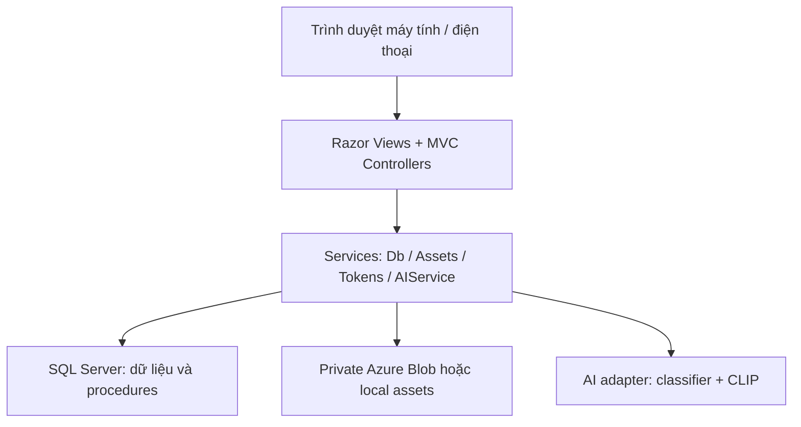
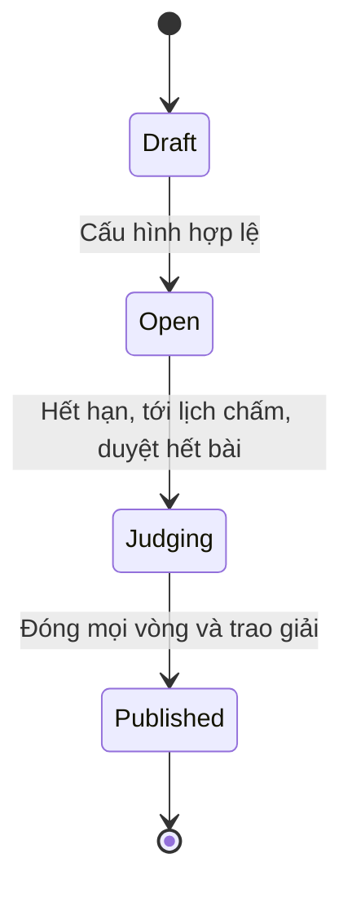
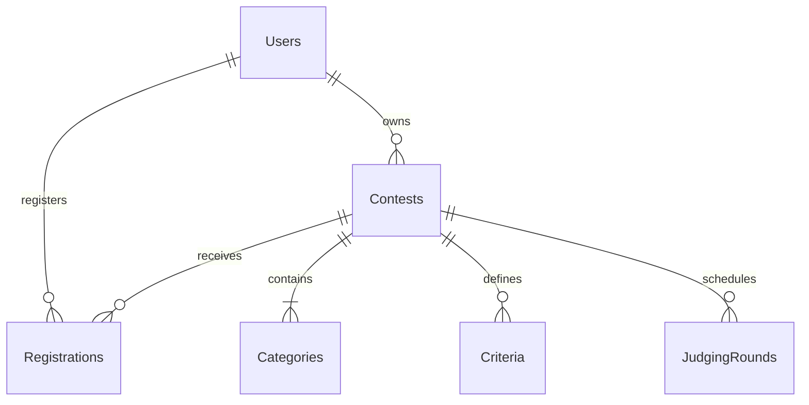
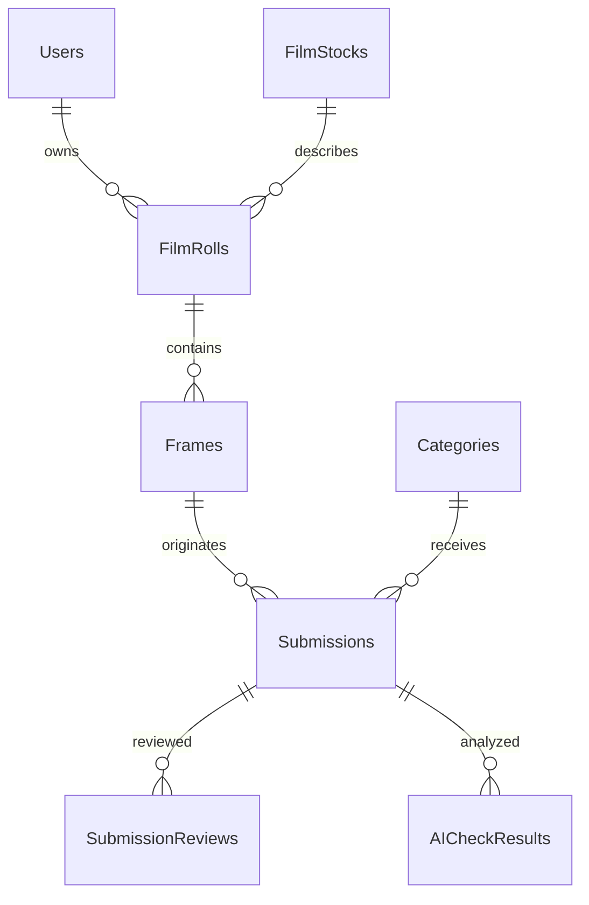
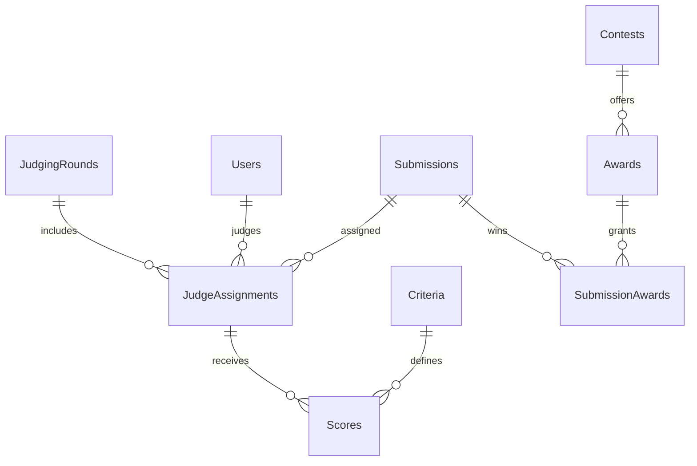

# REPO_HQTCSDL_NHOM10
# FilmRoom — Nền tảng cuộc thi nhiếp ảnh phim

ASP.NET Core MVC / C# / ADO.NET / SQL Server / T-SQL. Giao diện tiếng Việt, responsive, 4 vai trò. JWT trong cookie HttpOnly; các POST MVC dùng antiforgery. Đây là bộ mã nguồn và tài liệu triển khai. Không có website công khai, tài khoản đám mây hoặc detector AI đã được kích hoạt sẵn.

## Đọc theo thứ tự

1. `docs/START_HERE_VI.md`: cài đặt trên Windows, tạo database và chạy website.
2. `docs/PROJECT_REPORT.md`: phân tích, thiết kế, ERD, quy tắc và mô tả dữ liệu.
3. `docs/DEMO.md`: kịch bản trình diễn đủ 4 vai trò.
4. `docs/REQUIREMENTS.md`: đối chiếu yêu cầu, phần phụ thuộc dịch vụ.
5. `docs/DEPLOYMENT.md`: Docker, Azure SQL, Blob, HTTPS, backup.
6. `docs/VALIDATION.md` và `tests/README.md`: bằng chứng kiểm thử và các giới hạn.
7. `ai-service/README.md`: kích hoạt detector và phân loại ảnh bằng mô hình thật.

## Chạy nhanh sau khi cài .NET 8 SDK và SQL Server 2022

Mở PowerShell tại thư mục FilmContest. Chỉ khởi tạo trên một database mới; không chạy lại 01_schema.sql trên database đã có bảng.

```powershell
$env:FILM_DB_ADMIN='Server=localhost;Database=master;Integrated Security=True;Encrypt=True;TrustServerCertificate=True'
$env:FILM_APP_PASSWORD='YOUR_UNIQUE_APP_SQL_PASSWORD_AT_LEAST_16_CHARS'
dotnet run --project scripts/FilmContest.DbTool -- init .
dotnet run --project scripts/FilmContest.DbTool -- test .
```

Nếu instance là SQLEXPRESS, thay `localhost` bằng `localhost\SQLEXPRESS`. Đăng nhập SQL filmapp cần SQL Server bật Mixed Mode; có thể dùng Windows Authentication cho website chạy dưới tài khoản đã được cấp quyền phù hợp (xem hướng dẫn).

```powershell
cd src/FilmContest.Web
dotnet user-secrets set 'ConnectionStrings:SqlServer' 'Server=localhost;Database=FilmContest;User ID=filmapp;Password=YOUR_APP_SQL_PASSWORD;Encrypt=True;TrustServerCertificate=True'
dotnet user-secrets set 'Jwt:Key' 'YOUR_RANDOM_SECRET_AT_LEAST_32_BYTES'
dotnet user-secrets set 'Bootstrap:AdminEmail' 'admin@example.com'
dotnet user-secrets set 'Bootstrap:AdminPassword' 'YOUR_UNIQUE_ADMIN_PASSWORD_AT_LEAST_12_CHARS'
dotnet dev-certs https --trust
dotnet run
```

Mở URL HTTPS hiển thị trong console (launch profile mặc định https://localhost:7080). Chưa cấu hình secret thì ứng dụng chủ động dừng với thông báo thay vì chạy bằng khóa mặc định. Sau khi admin đầu tiên được tạo, xóa Bootstrap secrets; đăng ký các tài khoản còn lại rồi cấp quyền trong /Admin.

## Những gì website thực hiện

- Cuộc thi nháp/mở/chấm/công bố, thể lệ, lịch nhận bài và lịch chấm UTC, hạng mục và trọng số.
- Sao chép cấu hình cuộc thi thành mẫu cho sự kiện mới.
- Đăng ký, cuộn phim, khung hình, JPEG/PNG, metadata, theo dõi bài và phản hồi.
- Duyệt bài có lý do và audit; kiểm tra hạn, số bài, quyền sở hữu và trùng byte.
- Nhiều vòng chấm, phân công từng bài/từng vòng, điểm 0–10, khóa sau xác nhận.
- Điểm có trọng số, thứ hạng theo hạng mục ở vòng cuối, giữ đồng hạng; trao giải thủ công có kiểm tra và công bố.
- Kho ảnh đoạt giải công khai sau công bố, ảnh chưa công bố được kiểm soát quyền.
- Thống kê SQL, xuất CSV chống công thức bảng tính, quản lý vai trò và danh mục phim.
- dHash tìm ảnh gần giống; adapter và service Python cho phát hiện ảnh AI/gắn nhãn. Cần chọn detector, tải trọng số và cấu hình HTTPS.
- Local storage để phát triển, Azure Blob private container khi triển khai.

## Kiểm thử và build

```powershell
dotnet build src/FilmContest.Web -c Release
dotnet run --project tests/FilmContest.Checks -- .
```

Chạy SQL integration trên SQL Server riêng: DbTool mode `test`. Không suy diễn kiểm tra cú pháp SQL thành kiểm thử nghiệp vụ. Tài khoản runtime dùng film_runtime, không dùng sa/dbo khi vận hành.

## Cấu trúc

- src/FilmContest.Web: Controllers, Models, Services, Razor Views, CSS, Dockerfile.
- database: schema, procedure, management, permission, demo, backup/restore.
- scripts/FilmContest.DbTool: tạo database và chạy integration test bằng SqlClient.
- tests: checks chạy tự động và SQL workflow thực.
- ai-service: optional FastAPI + Transformers model adapter.
- docs: hướng dẫn, thiết kế, đối chiếu, kiểm thử, triển khai.

Không chứa mật khẩu hoạt động, API key, ảnh của người dùng hay trọng số mô hình. Không đưa .env, App_Data, user-secrets hoặc connection string thật lên GitHub.


# Mô-đun AI tùy chọn

Đây là adapter chạy mô hình thật bằng Transformers, không trả kết quả ngẫu nhiên. Cần chọn mô hình phát hiện ảnh sinh bởi AI và đánh giá trên tập ảnh phim/ảnh scan thực tế trước khi sử dụng. Không cung cấp hoặc giả định độ chính xác cho mô hình chưa được đánh giá.

1. Tạo Python virtualenv và cài requirements (máy cần đủ RAM cho PyTorch và các mô hình).
2. Chọn một image-classification detector từ nguồn bạn được phép sử dụng. Xác minh giấy phép, nhãn, version/revision và kết quả đánh giá. Đặt AI_DETECTOR_MODEL bằng model ID hoặc đường dẫn cục bộ. Đặt AI_POSITIVE_LABEL đúng nhãn biểu thị ảnh AI theo config của mô hình. Không đoán LABEL_0/LABEL_1.
3. AI_TAG_MODEL mặc định `openai/clip-vit-base-patch32`. Mô hình gợi ý 3 nhãn từ danh sách chủ đề; không tự quyết định hạng mục dự thi của tác giả.
4. Đặt AI_API_KEY ngẫu nhiên, ít nhất 24 ký tự. Khởi động service qua HTTPS (reverse proxy có chứng chỉ hợp lệ hoặc uvicorn --ssl-keyfile ... --ssl-certfile ...). Máy chạy service phải tải được trọng số từ Hugging Face hoặc sử dụng model cục bộ.

```powershell
python -m venv .venv
.\.venv\Scripts\Activate.ps1
pip install -r requirements.txt
$env:AI_API_KEY='YOUR_RANDOM_SERVICE_SECRET'
$env:AI_DETECTOR_MODEL='YOUR_EVALUATED_MODEL_ID_OR_PATH'
$env:AI_POSITIVE_LABEL='EXACT_AI_LABEL_FROM_MODEL_CONFIG'
uvicorn app:app --host 127.0.0.1 --port 8090 --ssl-keyfile key.pem --ssl-certfile cert.pem
```

Cấu hình website AI__Endpoint=https://ai.yourdomain/analyze, AI__ApiKey khớp secret, AI__ModelVersion ghi tên + revision của detector. Không đưa secret vào git. Chỉ kết nối endpoint do bạn quản lý. Upload ảnh lên dịch vụ bên ngoài phải phù hợp thể lệ và đồng ý của người dự thi.

Request: POST /analyze, header X-Api-Key, JSON `{ "imageBase64":"...", "mimeType":"image/jpeg" }`.
Response: `{ "aiProbability":0.25, "tags":["landscape","nature"] }`.
0.25 ở đây chỉ minh họa schema, không phải kết quả mô hình đã chạy. Dịch vụ không khởi động nếu thiếu detector hoặc cấu hình sai nhãn.

Website đánh dấu Flagged nếu điểm detector >=0.7. Điểm của classifier chưa được hiệu chuẩn không phải xác suất chắc chắn. Đánh giá false positive trên scan phim, hiệu chuẩn ngưỡng và lưu phiên bản trước khi triển khai thật. dHash trên website là thuật toán gần giống, không phải mô hình học máy. Báo cáo thống kê hiện dùng SQL, không tự sinh nội dung bằng LLM.


# Kịch bản demo trọn quy trình

Chuẩn bị: database đã tạo, website chạy, 4 tài khoản riêng có đúng vai trò. Dùng cửa sổ trình duyệt riêng từng người. Người dự thi chuẩn bị JPEG/PNG hợp lệ và thông tin cuộn phim. Dữ liệu AI cần endpoint thật nếu muốn demo kết quả detector; nếu không, trình bày Unavailable đúng thực trạng.

1. Admin: đăng nhập, mở /Admin, cho thấy danh sách vai trò, danh mục Kodak/Ilford/Fujifilm, settings và audit. Đăng ký trước các user còn lại rồi cấp Organizer/Judge. Đổi Banner và xem trang chủ.
2. Organizer: tạo cuộc thi “Ánh sáng trên phim”, hạng mục Đời sống, giới hạn 2 ảnh/người; nhận bài từ 5 phút trước đến vài phút sau hiện tại (UTC). Thêm Giải Nhất khi còn Draft; thể lệ ghi giải thưởng và quyền sử dụng ảnh.
3. Cho thấy tiêu chí mặc định 0.3/0.4/0.3. Nếu muốn tiêu chí riêng, xóa bộ và nhập lại có tổng bằng 1. Cấu hình lịch chấm sau hạn nhận bài. Mở cuộc thi.
4. Participant: mở chi tiết, đăng ký. Quản lý cuộn phim: tên “Cuộn 01”, chọn film stock, ISO, máy, lens, khổ, lab. Nộp ảnh với số khung 1, tiêu đề, địa điểm, scan và mã âm bản tùy chọn. Kiểm tra trạng thái Pending.
5. Thử gửi cùng ảnh để minh họa UNIQUE hash, hoặc vượt số lượng. Không cần cố gây lỗi mọi tình huống trong một demo.
6. Organizer: mở Kiểm tra, xem ảnh và metadata, AI checks, duyệt kèm lý do. Nếu provider chưa cấu hình, nói rõ không có kết quả detector, không gọi Unavailable là ảnh thật.
7. Sau hạn và tới lịch chấm: bấm Bắt đầu chấm. Nếu chưa đủ điều kiện, giải thích lỗi; không chỉnh đồng hồ hệ thống. Phân công bài Approved cho Judge ở vòng 1.
8. Judge: mở Bàn chấm thi; xem ảnh và thông số (không lộ tên tác giả trong màn chấm); nhập điểm từng tiêu chí, lưu, sau cùng xác nhận hoàn tất. Ví dụ 8 / 9 / 7 → 8×0.3+9×0.4+7×0.3=8.1.
9. Organizer: kiểm tra phân công đã Finalized; đóng vòng. Nếu cần demo nhiều vòng, tạo vòng tiếp theo, phân công lại, chấm và đóng; điểm cuối lấy vòng có số lớn nhất, không cộng mọi vòng.
10. Chọn giải và bài được trao, kiểm tra rồi công bố. Trang kết quả hiển thị hạng; triển lãm hiển thị ảnh đoạt giải và metadata.
11. Participant: mở Phản hồi, xem lý do duyệt và điểm/nhận xét sau công bố.
12. Organizer: xem báo cáo theo hạng mục và tải CSV. Admin: xem audit tạo cuộc thi/duyệt/công bố.
13. Với SSMS: trình bày FK, CHECK, UNIQUE, procedure usp_Submit/usp_Score, transaction và views; chạy tests/01_workflow.sql trên database thử nghiệm, giữ output thật để đưa vào báo cáo.

Ảnh chụp minh chứng nên gồm: ERD, bảng dữ liệu, thủ tục và kết quả kiểm thử, các màn tạo/nộp/duyệt/chấm/kết quả/triển lãm. Không chụp connection string, API key hoặc mật khẩu vào báo cáo.
# Triển khai và vận hành

## Local với Docker Desktop

Cần Docker Desktop chạy Linux containers. Copy .env.example thành .env, thay TẤT CẢ placeholder. Không commit .env.

1. `docker compose up -d sql`.
2. Dùng SSMS kết nối localhost,1433 bằng sa và SQL_SA_PASSWORD đã đặt. Chạy script 01/02/03, tạo LOGIN filmapp với mật khẩu tương ứng APP_SQL_CONNECTION, rồi chạy 04/05. Hoặc dùng DbTool init từ máy host, FILM_DB_ADMIN trỏ localhost,1433 và FILM_APP_PASSWORD trùng app login.
3. `docker compose --profile app up -d --build web`.
4. Mở http://localhost:5080. Compose mặc định Development và bind localhost để demo; không dùng trực tiếp cấu hình này làm site Internet.
5. `docker compose logs web` hoặc `docker compose logs sql` để kiểm tra. Không đưa log chứa secret ra nơi công khai. `docker compose down` dừng nhưng giữ volume. KHÔNG dùng down -v nếu cần giữ dữ liệu.

Compose yêu cầu khai báo .env đầy đủ ngay cả khi mới khởi động sql vì nội suy tất cả service. SQL Server Developer dành phát triển/kiểm thử; chọn edition/licensing phù hợp nếu triển khai vận hành thật.

## Azure hoặc host Windows/Linux

Cần người dùng tự có subscription/host và quyền tạo dịch vụ. Bộ mã không có tài khoản cloud; không có deployment công khai đã chạy.

1. Tạo SQL Server trên VM hoặc Azure SQL. Với Azure SQL, tạo database qua portal/CLI trước; bỏ USE master/CREATE DATABASE/USE FilmContest trong script khi kết nối trực tiếp database vì khác SQL Server instance. Dùng contained database user thay CREATE LOGIN nếu phương án Azure SQL yêu cầu. Thiết lập firewall chỉ cho backend. Không dùng sa cho app.
2. Chạy schema/procedures và kiểm thử trên staging. Cấp runtime quyền tương ứng 04_security; bootstrap admin procedure cần được cấp execute. Dùng secret store hoặc managed identity theo môi trường; adapter hiện hỗ trợ connection string.
3. Tạo Azure Storage account và private Blob container `film-assets`. Tắt public access, đặt retention/soft delete phù hợp. App cần quyền đọc/ghi/xóa blob, không cần quyền quản trị toàn subscription.
4. Đặt Storage__Provider=Azure; Storage__AzureConnectionString và Storage__Container qua environment/secret manager. Adapter dùng connection string; chưa triển khai credential rotation tự động.
5. Publish: `dotnet publish src/FilmContest.Web -c Release -o publish`. Chạy app qua host ASP.NET hoặc Dockerfile. Đặt ASPNETCORE_ENVIRONMENT=Production, AllowedHosts theo tên miền thật, Jwt__Key đủ mạnh, ConnectionStrings__SqlServer dùng Encrypt=True và chứng chỉ hợp lệ (không TrustServerCertificate=True khi vận hành thật).
6. Bật HTTPS với chứng chỉ hợp lệ. Nếu reverse proxy kết thúc TLS, cấu hình Hosting__KnownProxy bằng đúng địa chỉ IP proxy để xử lý X-Forwarded-Proto; không tin mọi proxy tùy ý. Với hạ tầng proxy động, cấu hình trust theo môi trường trước khi triển khai. Xác nhận không có vòng lặp HTTPS và cookie có Secure/HttpOnly.
7. Cấu hình AI service HTTPS và model version theo ai-service/README.md. Khóa service khác khóa JWT. API key chỉ lưu backend.
8. Lưu Data Protection keys ra nơi bền vững và bảo vệ bằng cơ chế của host; nếu chạy nhiều instance, chia sẻ key ring để antiforgery hoạt động giữa các instance. File App_Data local chỉ dùng phát triển hoặc volume bền vững; môi trường nhiều instance nên Azure Blob.
9. Xóa Bootstrap admin secrets sau tạo lần đầu. Đăng nhập thử mọi vai trò, thử quyền tải ảnh, CSRF, SQL hạn mức, AI lỗi, restore và kiểm thử tải trước khi mở cho người thật.

## Sao lưu

06_backup_restore.sql là mẫu dành SQL Server instance. Đường dẫn ở máy chủ SQL phải tồn tại và service SQL có quyền ghi. Không chạy restore đè database thật. Sao lưu và kiểm tra cả database, assets/blob và cấu hình vận hành theo chính sách. Không lưu API key cùng gói báo cáo công khai. Azure SQL dùng cơ chế backup/restore phù hợp dịch vụ thay lệnh backup-to-disk của SQL Server.

## Những việc cần làm trước nghiệm thu vận hành

- Chạy SQL workflow và kiểm thử nhiều request cùng lúc trên SQL Server thật.
- Chạy model, ghi model revision, tập dữ liệu và false-positive/false-negative trên ảnh phim.
- Đo kích thước upload, thời gian phản hồi, RAM của model và SQL; AI synchronous có thể kéo dài request, nên chuyển sang background queue nếu tải cao.
- Có quy trình khôi phục, dọn file orphan và giám sát lỗi.
- Chọn cấp phép hạ tầng và thư viện phù hợp; SkiaSharp là thư viện xử lý ảnh thay cho ImageSharp cũ có cảnh báo/license build.

Đây là cấu hình và hướng dẫn triển khai, không phải xác nhận production đã được vận hành hoặc kiểm thử.
# Báo cáo kỹ thuật — FilmRoom

Tên đề tài: Nền tảng tổ chức và quản lý cuộc thi nhiếp ảnh phim tích hợp trí tuệ nhân tạo.

Tài liệu mô tả triển khai trong mã nguồn. Sinh viên bổ sung thông tin lớp, nhóm, giảng viên, ảnh chụp kết quả chạy trên máy và số liệu đánh giá thực tế. Không sử dụng kế hoạch kiểm thử như bằng chứng đã kiểm thử.

## 1. Bối cảnh và mục tiêu

Cuộc thi ảnh phim cần lưu cả tệp ảnh scan và thông tin về cuộn phim, khung hình, máy ảnh, ống kính, ISO, lab và scan. Việc dùng biểu mẫu, email và bảng tính rời nhau gây khó kiểm soát hạn nhận bài, xác minh tác phẩm và tổng hợp điểm. FilmRoom tập trung quy trình này vào một website, duy trì liên kết nguồn gốc tác phẩm và lưu lịch sử đánh giá.

Mục tiêu: quản lý nhiều cuộc thi; đăng ký/nộp ảnh; kiểm duyệt; chấm theo tiêu chí và vòng; tổng hợp điểm; trao giải/công bố; lưu kho; hỗ trợ phân tích ảnh. Cơ sở dữ liệu dùng SQL Server/T-SQL theo môn học, thay cho PostgreSQL/MySQL gợi ý trong đề gốc. Website responsive là sản phẩm theo hướng 2 đã chọn, không bao gồm ứng dụng Flutter riêng.

## 2. Vai trò

Mỗi tài khoản có một vai trò tại một thời điểm: Admin, Organizer, Judge hoặc Participant. Admin cấp vai trò, không có chức năng tự đăng ký làm giám khảo. Với một người cần nhiều vai trò đồng thời, phiên bản này cần mở rộng bảng UserRoles và cơ chế chọn vai trò; không tuyên bố đã hỗ trợ yêu cầu đó.

Participant quản lý hồ sơ và cuộn phim, đăng ký, nộp bài, theo dõi duyệt và điểm sau công bố. Organizer sở hữu cuộc thi, cấu hình và kiểm duyệt, phân công, quản lý vòng và giải. Judge chỉ chấm bài được giao. Admin quản trị toàn nền tảng, cấu hình Banner/RequireNegative, danh mục phim, quyền và nhật ký.

## 3. Kiến trúc



Controller kiểm tra đăng nhập, vai trò, quyền sở hữu và dữ liệu đầu vào; procedures kiểm tra các điều kiện nghiệp vụ quan trọng trong transaction. ADO.NET truyền tham số, không ghép chuỗi từ dữ liệu biểu mẫu thành SQL. Dữ liệu ảnh ở private storage; SQL lưu AssetKey và hash. AssetsController kiểm tra quyền trước khi đọc ảnh, không công khai toàn container.

## 4. Quy trình nghiệp vụ



Submission: Pending → Approved hoặc Rejected; có thể duyệt lại khi cuộc thi chưa chấm. Khi vào Judging, quyết định kiểm duyệt khóa. Round: Draft → Open → Closed; vòng tiếp theo chỉ tạo sau khi mọi vòng trước đã đóng. Bản đầu cho tất cả bài Approved tham gia các vòng; chưa có cơ chế loại dần theo top-N.

### Quy tắc

1. Email duy nhất, mật khẩu băm; người dùng mới là Participant.
2. Opens < Closes; JudgingStart > Closes; JudgingEnd > JudgingStart. Tất cả UTC.
3. Đăng ký/nộp bài chỉ khi trạng thái Open và thời gian hợp lệ.
4. Người nộp phải đăng ký; cuộn phim phải thuộc họ; hạng mục phải thuộc cuộc thi.
5. Không quá MaxEntries; bài bị từ chối vẫn tính vào số lần nộp trong bản này.
6. Không lặp cùng khung hình hoặc cùng SHA-256 trong một cuộc thi. Một khung hình được tham gia các cuộc thi khác nhau nếu thể lệ cho phép.
7. Frame metadata được tạo lần đầu và tái sử dụng khi cùng RollId/FrameNumber; không tự ghi đè lịch sử cũ khi nộp lại sang cuộc thi khác.
8. Tổng trọng số tiêu chí bằng 1 trước khi mở thi; tiêu chí khóa khi đã mở.
9. Chỉ Approved được phân công. Giám khảo phải active và có role Judge; không tự chấm bài của mình.
10. Điểm từng tiêu chí 0–10, chỉ chấm trong lịch chấm và vòng Open. Một bộ điểm duy nhất mỗi Assignment/Criterion.
11. Phải chấm đủ tiêu chí trước khi Finalize; không sửa sau Finalize.
12. Mỗi bài Approved phải được phân công ít nhất một giám khảo trong mỗi vòng; đóng vòng chỉ khi tất cả phân công đã xác nhận. Số giám khảo giữa các bài có thể khác nhau; nên áp dụng cùng một hội đồng theo quy định cuộc thi để bảo đảm công bằng.
13. Điểm giám khảo = tổng điểm tiêu chí × trọng số; điểm cuối = trung bình các giám khảo ở vòng có RoundNumber cao nhất. Các vòng trước phục vụ lịch sử.
14. RANK phân theo ContestId/CategoryId, giữ đồng điểm. Ban tổ chức chọn giải sau khi xem xếp hạng; không tự phá đồng điểm bằng ID.
15. Công bố sau khi mọi vòng Closed và có ít nhất một giải được trao. Không sửa điểm hoặc giải sau công bố trong bản này.
16. Kho công khai chứa ảnh được trao giải thuộc cuộc thi Published; không tự công khai ảnh bị loại.
17. AI là hỗ trợ, không tự từ chối. Unavailable không có nghĩa ảnh thật/giả.

## 5. ERD theo nhóm

### Người dùng và cuộc thi



### Nguồn gốc ảnh



### Chấm và trao giải



## 6. Từ điển dữ liệu tóm tắt

| Bảng | Khóa chính | Dữ liệu chính và quan hệ |
|---|---|---|
| PlatformSettings | SettingKey | Banner, RequireNegative; không chứa secret |
| Users | UserId | Email UNIQUE, Name, PasswordHash, Role, Active, TokenVersion |
| Contests | ContestId | OwnerId → Users; Title, Rules, Opens/Closes, lịch chấm, MaxEntries, Status |
| Categories | CategoryId | ContestId; UNIQUE(ContestId,Name), UNIQUE(ContestId,CategoryId) |
| Registrations | ContestId,UserId | Hai FK tới cuộc thi và người dùng; RegisteredAt |
| FilmStocks | StockId | Brand, Name, DefaultISO, Active; danh mục phim |
| FilmRolls | RollId | UserId, StockId, Name, Stock snapshot, ISO, Camera, Lens, Format, Lab |
| Frames | FrameId | RollId, FrameNumber, Location, ScanSpecs, NegativeReference |
| Submissions | SubmissionId | FK kép cuộc thi/hạng mục và cuộc thi/người đăng ký; FrameId, Title, AssetKey, hash, kích thước, trạng thái |
| SubmissionReviews | ReviewId | SubmissionId, ReviewerId, Decision, Reason, ReviewedAt |
| Criteria | CriterionId | ContestId, Name, Weight (0,1] |
| JudgingRounds | RoundId | ContestId, Name, RoundNumber, State |
| JudgeAssignments | AssignmentId | RoundId, SubmissionId, JudgeId, Finalized |
| Scores | AssignmentId,CriterionId | Score 0–10, Comment, UpdatedAt |
| Awards | AwardId | ContestId, Name, Prize |
| SubmissionAwards | AwardId,SubmissionId | Bài được trao giải |
| AICheckResults | CheckId | SubmissionId, Kind, Status, Score, Detail, ModelVersion, CheckedAt |
| AuditLog | AuditId | ActorId, Action, EntityId, Detail, OccurredAt |

Kiểu và độ dài chính xác xem 01_schema.sql. int IDENTITY dùng cho định danh; datetime2 cho thời gian; nvarchar cho tiếng Việt; decimal cho điểm/trọng số; bit cho cờ. Không dùng float cho điểm tổng hợp.

### Chuẩn hóa

Các quan hệ nhiều-nhiều được tách qua Registrations, JudgeAssignments và SubmissionAwards. Metadata cuộn phim không lặp trong từng bài; frame không lặp theo RollId/FrameNumber. Scores phụ thuộc đầy đủ vào AssignmentId/CriterionId. Không lưu điểm tổng và hạng để tránh lệch khi dữ liệu chấm thay đổi; dùng views. FilmRolls.Stock là snapshot có chủ ý giữ tên phim lúc ghi nhận; FilmStocks vẫn là danh mục tham chiếu. Phần snapshot này là dữ liệu lịch sử có lặp kiểm soát, không tuyên bố mọi cột đều được chuẩn hóa tuyệt đối.

## 7. Các đối tượng T-SQL

- 01_schema: 18 bảng, FK/UNIQUE/CHECK, chỉ mục, v_RoundScores, v_Rankings, v_Archive, trigger audit kiểm duyệt.
- 02_procedures: tạo cuộc thi, đăng ký, nộp, duyệt, bắt đầu chấm, phân công, chấm, xác nhận, đóng vòng, công bố, lưu AI.
- 03_management: mở, cấu hình, sao chép mẫu, vòng tiếp theo, trao giải, đổi quyền, lịch chấm, danh mục phim, settings.
- 04_security: role film_runtime và quyền tối thiểu theo kiến trúc shared application login.
- 05_demo: cuộc thi minh họa không có mật khẩu dùng chung.
- 06_backup_restore: mẫu backup, verify và phục hồi sang database kiểm tra.

Giao dịch nộp giữ UPDLOCK/HOLDLOCK trên contest để hạn mức không bị vượt khi hai yêu cầu đồng thời. Tradeoff: các lần nộp cùng cuộc thi được tuần tự hóa ở bước ghi database. Chỉ mục hỗ trợ hàng đợi theo cuộc thi/trạng thái, hash và phân công theo giám khảo. Chưa có benchmark tải để khẳng định số người dùng/giây.

SQL shared login chỉ dành backend tin cậy. Không cung cấp connection string hoặc quyền EXECUTE trực tiếp cho người dùng trình duyệt. ActorId được server lấy từ JWT, không lấy từ input. Stored procedures có ActorId không thay thế danh tính SQL riêng từng người nếu cho phép người dùng truy cập database trực tiếp.

## 8. Bảo mật và lưu trữ

JWT xác minh chữ ký, issuer, audience, hết hạn; cookie HttpOnly/SameSite Strict, Secure khi HTTPS; token version kiểm tra lại trong DB để thu hồi phiên khi logout, khóa hoặc đổi quyền. PasswordHasher của ASP.NET Core thực hiện băm có salt; không tự xây thuật toán băm. Antiforgery cho POST, rate-limit đăng nhập/đăng ký, kiểm tra owner, mã hóa output Razor, CSV escape, kiểm tra nội dung ảnh và giới hạn kích thước.

Upload chỉ JPEG/PNG hợp lệ, giới hạn 10MB và 40MP; decode, xoay theo EXIF, encode lại JPEG, không giữ EXIF/metadata nhúng. Metadata phim nhập riêng vẫn tồn tại trong database. Lưu file private; không đặt trong wwwroot. Tệp đã lưu được xóa khi nghiệp vụ nộp thất bại trong nhánh xử lý lỗi dự kiến; lỗi hạ tầng bất ngờ có thể cần tác vụ dọn orphan theo đối chiếu AssetKey. Chưa có antivirus hoặc hàng đợi scan bất đồng bộ.

## 9. AI và thống kê

SHA-256 chặn trùng byte trong một cuộc thi. dHash-64 so với tối đa 2.000 bài gần nhất; khoảng cách Hamming ≤6 đánh dấu gần giống. Có false positive/negative; crop mạnh hoặc biến đổi màu có thể không được phát hiện. Không gọi thuật toán này là mô hình AI.

ai-service chạy classifier đã cấu hình và CLIP gợi ý nhãn. Không có detector mặc định vì nhãn và độ tin cậy phải được đánh giá trên ảnh phim thực. AIService gọi HTTPS và lưu trạng thái, score, model version. Endpoint thiếu/hỏng trả Unavailable; không tạo kết quả giả. Service Python đã được cung cấp mã nguồn, chưa tải/chạy/đánh giá mô hình trong môi trường bàn giao. Báo cáo số lượng và bảng điểm dùng SQL, không sinh báo cáo bằng LLM.

## 10. Kiểm thử, triển khai và hạn chế

Đọc VALIDATION.md để biết kiểm tra đã chạy. Đọc tests/README.md cho ma trận tình huống và SQL integration script. Chưa có bằng chứng đạt toàn bộ nghiệp vụ trên SQL Server hoặc tải đồng thời trong môi trường này.

Triển khai cần SQL Server/Azure SQL, private Blob, host ASP.NET, HTTPS và secrets; không có sẵn cloud resource. Các mục ngoài phạm vi bản đầu: app Flutter riêng, thanh toán, email reset mật khẩu/xác thực email, tự loại top-N qua vòng, phúc khảo và thu hồi công bố, hoàn thiện SSO/OIDC, LLM analytics, tải trọng số detector, benchmark và đánh giá detector. Nếu giảng viên yêu cầu các mục đó, phải triển khai/kiểm thử bổ sung trước nghiệm thu.

## 11. Tài liệu tham khảo đã đối chiếu

- Microsoft: Developing ASP.NET Core MVC apps — https://learn.microsoft.com/en-us/dotnet/architecture/modern-web-apps-azure/develop-asp-net-core-mvc-apps
- Microsoft: Configure JWT bearer authentication — https://learn.microsoft.com/en-us/aspnet/core/security/authentication/configure-jwt-bearer-authentication?view=aspnetcore-8.0

Các nguồn này dùng để đối chiếu kiến trúc MVC và xác minh JWT; không phải bằng chứng về hiệu năng hay độ chính xác AI của sản phẩm.
# Bắt đầu trên Windows

## 1. Chuẩn bị

Cài .NET 8 SDK, Visual Studio có workload ASP.NET and web development (hoặc VS Code + CLI), SQL Server 2022 Developer/Express và SQL Server Management Studio. SQL Server là dịch vụ database; SSMS chỉ là công cụ kết nối. Có SSMS chưa có nghĩa đã cài SQL Server.

Chạy `dotnet --info` trong PowerShell. Mở SSMS, kết nối instance của bạn, chạy `SELECT @@VERSION;`. Ghi lại tên server, ví dụ localhost, .\SQLEXPRESS hoặc TENMAY\SQLEXPRESS. Không giả định mọi máy có cùng tên instance.

## 2. Giải nén và mở dự án

Giải nén FilmContest.zip. Trong Visual Studio chọn Open a project, mở `src/FilmContest.Web/FilmContest.Web.csproj`. CLI có thể chạy từ thư mục gốc FilmContest. Có thể mở FilmContest.sln và chọn FilmContest.Web làm Startup Project. Không cần tạo dự án MVC mới rồi copy từng file.

## 3. Tạo cơ sở dữ liệu

Có hai lựa chọn, chỉ dùng một.

### A. Dùng công cụ kèm theo

Mở PowerShell tại thư mục FilmContest. Đặt FILM_DB_ADMIN theo kết nối tài khoản có quyền tạo database và login. Nếu dùng Windows Authentication:

```powershell
$env:FILM_DB_ADMIN='Server=localhost\SQLEXPRESS;Database=master;Integrated Security=True;Encrypt=True;TrustServerCertificate=True'
$env:FILM_APP_PASSWORD='YOUR_UNIQUE_STRONG_PASSWORD_16_OR_MORE_CHARS'
dotnet run --project scripts/FilmContest.DbTool -- init .
```

Tool tạo database, bảng, procedures, login filmapp, phân quyền và cuộc thi minh họa. `init` chỉ chạy một lần trên database sạch; không xóa dữ liệu sẵn có để chạy lại. Nếu lần đầu lỗi giữa chừng, đọc lỗi và tiếp tục các script chưa hoàn thành bằng SSMS, không xóa database thật.

### B. Dùng SSMS

1. Mở và chạy database/01_schema.sql.
2. Chạy 02_procedures.sql.
3. Chạy 03_management.sql.
4. Với quyền DBA, tạo login: `CREATE LOGIN filmapp WITH PASSWORD='YOUR_UNIQUE_STRONG_PASSWORD', CHECK_POLICY=ON;` trong master. Không dùng mật khẩu mẫu trong triển khai thật.
5. Chạy 04_security.sql.
6. Tùy chọn chạy 05_demo.sql. Không chạy 06_backup_restore.sql trước khi cấu hình đường dẫn sao lưu.

Nếu dùng SQL Authentication cho filmapp: SQL Server phải bật SQL Server and Windows Authentication mode; khởi động lại dịch vụ sau khi đổi. Kiểm tra TCP/IP và cổng nếu kết nối bằng host,port. Không mở cổng database ra Internet.

Có thể dùng Windows Authentication cho ứng dụng local: tạo database user cho đúng Windows identity và cấp film_runtime, sau đó dùng Integrated Security=True. Quyền INSERT Users, INSERT FilmRolls và UPDATE Name/TokenVersion được cấp trong 04_security; membership chỉ có hiệu lực khi user ứng dụng thuộc role này.

## 4. Cấu hình website

Vào thư mục src/FilmContest.Web và chạy các lệnh user-secrets trong README. Connection string phải trỏ đúng instance và mật khẩu login filmapp. JWT secret dùng giá trị ngẫu nhiên dài ít nhất 32 byte; ví dụ tạo bằng PowerShell:

```powershell
$bytes = New-Object byte[] 48
$rng = [System.Security.Cryptography.RandomNumberGenerator]::Create()
$rng.GetBytes($bytes)
$jwtSecret = [Convert]::ToBase64String($bytes)
dotnet user-secrets set 'Jwt:Key' $jwtSecret
```

Các secret Bootstrap tạo admin đầu tiên nếu database chưa có admin. Website không tạo admin mặc định từ một mật khẩu dùng chung. Sau đăng nhập thành công, xóa hai Bootstrap secrets bằng `dotnet user-secrets remove ...`.

## 5. Chạy

```powershell
dotnet dev-certs https --trust
dotnet build
dotnet run
```

Mở https://localhost:7080 nếu đang dùng launchSettings kèm theo. Đăng nhập bằng admin đã cấu hình. Dùng trình duyệt khác hoặc cửa sổ riêng tư để demo nhiều tài khoản; không chia sẻ cookie.

## 6. Tạo tài khoản và cấp vai trò

Đăng ký 3 tài khoản: người dự thi, ban tổ chức, giám khảo. Tài khoản mới luôn là Participant. Admin mở /Admin, chọn role thích hợp từng người và bấm Lưu, giữ checkbox Hoạt động. Không đổi vai trò tài khoản admin đang dùng. Người được đổi role cần đăng nhập lại.

## 7. Tạo cuộc thi thật đầu tiên

Ban tổ chức vào /Organizer/Create, nhập tên, thể lệ, ngày mở/đóng UTC và hạng mục đầu tiên. Tại trang quản lý: thêm giải, cấu hình tiêu chí (tổng trọng số = 1), điều chỉnh lịch chấm rồi mở nhận bài. Tiêu chí mặc định 30% bố cục + 40% sáng tạo/câu chuyện + 30% kỹ thuật. Có thể xóa bộ tiêu chí khi còn nháp để nhập bộ mới (hạt phim, sắc độ, màu, scan…).

Ngày chấm mặc định bắt đầu 1 phút sau khi đóng nhận bài, kết thúc sau 14 ngày. Để demo, đặt hạn nhận bài vài phút sau hiện tại; hoàn tất đăng ký/nộp trong khoảng đó. Không sửa thời gian máy tính. Thời gian Việt Nam = UTC + 7; ví dụ 19:00 Việt Nam nhập 12:00 UTC cùng ngày.

## 8. Kiểm tra

Từ thư mục gốc, chạy checks và DbTool test theo README. Sau đó thực hiện docs/DEMO.md. Ảnh tự chụp hoặc có quyền sử dụng, JPEG/PNG tối thiểu 800×600. Quản lý cuộn phim trước khi nộp.

## Lỗi thường gặp

| Hiện tượng | Kiểm tra |
|---|---|
| Configure Jwt__Key | Chưa đặt secret hoặc đặt ở sai csproj |
| Login failed for filmapp | Mật khẩu, Mixed Mode, login bị khóa, tên instance |
| Cannot open database | Chưa chạy schema hoặc trỏ sai server |
| Invalid object/procedure | Thiếu script hoặc chưa chạy 03_management |
| User permission denied | 04_security và database user membership |
| Ảnh không nộp được | Đã đăng ký? đúng hạn? cuộn phim của mình? ảnh đủ kích thước? |
| AI Unavailable | Chưa cấu hình AI endpoint/model hoặc provider thất bại |
| Không bắt đầu chấm | Hết hạn nhận bài chưa? đến lịch chấm chưa? còn bài Pending? |
| Không công bố | Các vòng đã đóng? đủ bài được chấm? đã trao giải? |
| Runtime SkiaSharp native error | Restore đúng RID; dùng Docker image Debian kèm native Linux assets |

Ứng dụng cần được build và chạy trên máy của bạn; file ZIP không phải APK hoặc file .exe độc lập.
