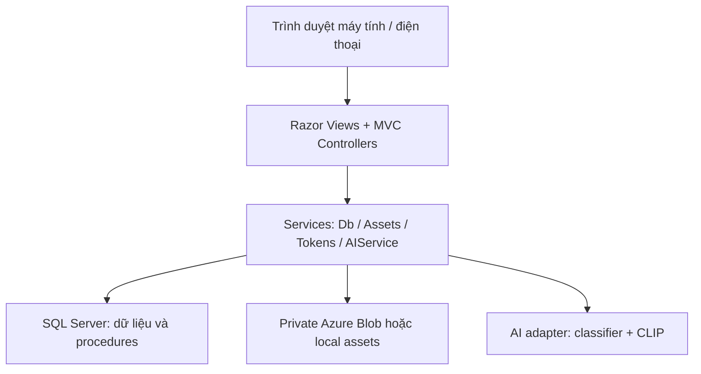
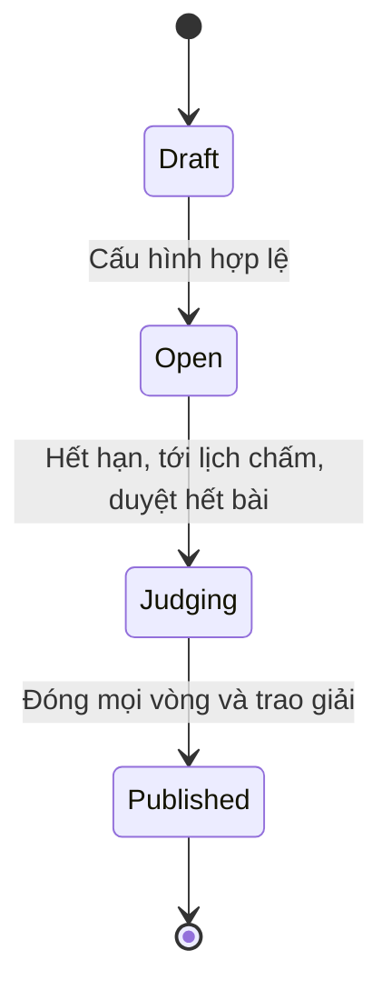
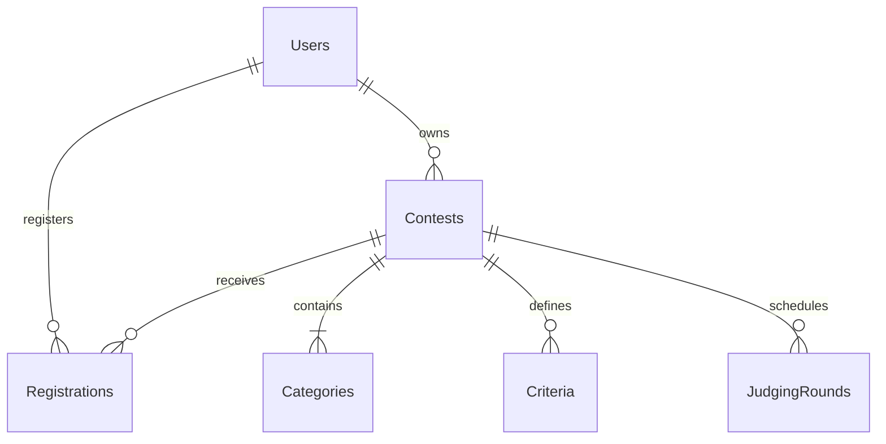
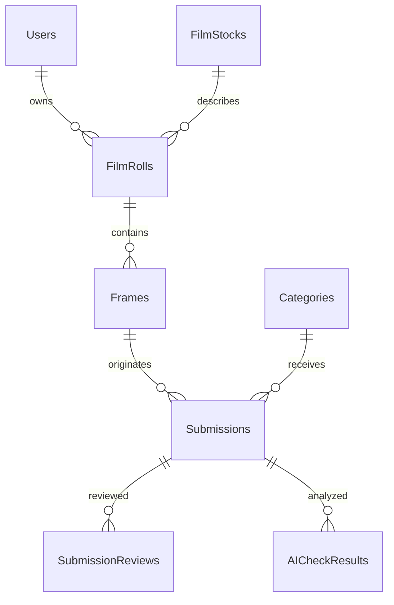
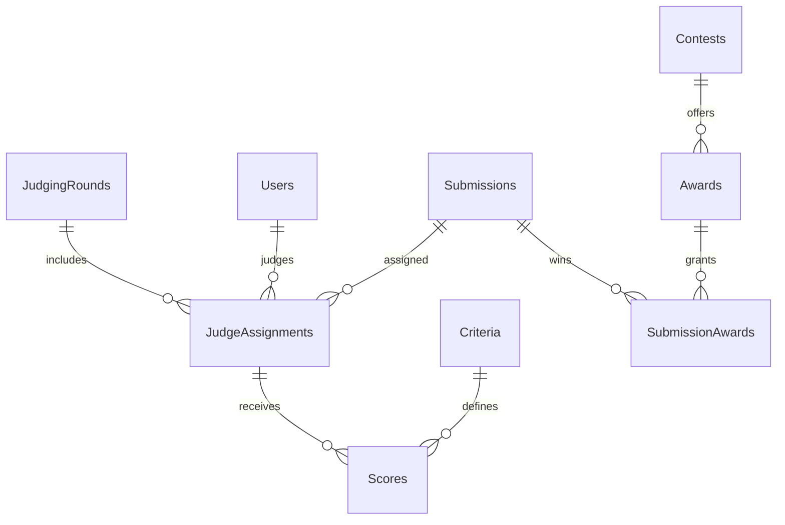

# Báo cáo kỹ thuật — FilmRoom

Tên đề tài: Nền tảng tổ chức và quản lý cuộc thi nhiếp ảnh phim tích hợp trí tuệ nhân tạo.

Tài liệu mô tả triển khai trong mã nguồn. Sinh viên bổ sung thông tin lớp, nhóm, giảng viên, ảnh chụp kết quả chạy trên máy và số liệu đánh giá thực tế. Không sử dụng kế hoạch kiểm thử như bằng chứng đã kiểm thử.

## 1. Bối cảnh và mục tiêu

Cuộc thi ảnh phim cần lưu cả tệp ảnh scan và thông tin về cuộn phim, khung hình, máy ảnh, ống kính, ISO, lab và scan. Việc dùng biểu mẫu, email và bảng tính rời nhau gây khó kiểm soát hạn nhận bài, xác minh tác phẩm và tổng hợp điểm. FilmRoom tập trung quy trình này vào một website, duy trì liên kết nguồn gốc tác phẩm và lưu lịch sử đánh giá.

Mục tiêu: quản lý nhiều cuộc thi; đăng ký/nộp ảnh; kiểm duyệt; chấm theo tiêu chí và vòng; tổng hợp điểm; trao giải/công bố; lưu kho; hỗ trợ phân tích ảnh. Cơ sở dữ liệu dùng SQL Server/T-SQL theo môn học, thay cho PostgreSQL/MySQL gợi ý trong đề gốc. Website responsive là sản phẩm theo hướng 2 đã chọn, không bao gồm ứng dụng Flutter riêng.

## 2. Vai trò

Mỗi tài khoản có một vai trò tại một thời điểm: Admin, Organizer, Judge hoặc Participant. Admin cấp vai trò, không có chức năng tự đăng ký làm giám khảo. Với một người cần nhiều vai trò đồng thời, phiên bản này cần mở rộng bảng UserRoles và cơ chế chọn vai trò; không tuyên bố đã hỗ trợ yêu cầu đó.

Participant quản lý hồ sơ và cuộn phim, đăng ký, nộp bài, theo dõi duyệt và điểm sau công bố. Organizer sở hữu cuộc thi, cấu hình và kiểm duyệt, phân công, quản lý vòng và giải. Judge chỉ chấm bài được giao. Admin quản trị toàn nền tảng, cấu hình Banner/RequireNegative, danh mục phim, quyền và nhật ký.

## 3. Kiến trúc

Controller kiểm tra đăng nhập, vai trò, quyền sở hữu và dữ liệu đầu vào; procedures kiểm tra các điều kiện nghiệp vụ quan trọng trong transaction. ADO.NET truyền tham số, không ghép chuỗi từ dữ liệu biểu mẫu thành SQL. Dữ liệu ảnh ở private storage; SQL lưu AssetKey và hash. AssetsController kiểm tra quyền trước khi đọc ảnh, không công khai toàn container.

## 4. Quy trình nghiệp vụ

Submission: Pending → Approved hoặc Rejected; có thể duyệt lại khi cuộc thi chưa chấm. Khi vào Judging, quyết định kiểm duyệt khóa. Round: Draft → Open → Closed; vòng tiếp theo chỉ tạo sau khi mọi vòng trước đã đóng. Bản đầu cho tất cả bài Approved tham gia các vòng; chưa có cơ chế loại dần theo top-N.

### Quy tắc

1. Email duy nhất, mật khẩu băm; người dùng mới là Participant.
2. Opens < Closes; JudgingStart > Closes; JudgingEnd > JudgingStart. Tất cả UTC.
3. Đăng ký/nộp bài chỉ khi trạng thái Open và thời gian hợp lệ.
4. Người nộp phải đăng ký; cuộn phim phải thuộc họ; hạng mục phải thuộc cuộc thi.
5. Không quá MaxEntries; bài bị từ chối vẫn tính vào số lần nộp trong bản này.
6. Không lặp cùng khung hình hoặc cùng SHA-256 trong một cuộc thi. Một khung hình được tham gia các cuộc thi khác nhau nếu thể lệ cho phép.
7. Frame metadata được tạo lần đầu và tái sử dụng khi cùng RollId/FrameNumber; không tự ghi đè lịch sử cũ khi nộp lại sang cuộc thi khác.
8. Tổng trọng số tiêu chí bằng 1 trước khi mở thi; tiêu chí khóa khi đã mở.
9. Chỉ Approved được phân công. Giám khảo phải active và có role Judge; không tự chấm bài của mình.
10. Điểm từng tiêu chí 0–10, chỉ chấm trong lịch chấm và vòng Open. Một bộ điểm duy nhất mỗi Assignment/Criterion.
11. Phải chấm đủ tiêu chí trước khi Finalize; không sửa sau Finalize.
12. Mỗi bài Approved phải được phân công ít nhất một giám khảo trong mỗi vòng; đóng vòng chỉ khi tất cả phân công đã xác nhận. Số giám khảo giữa các bài có thể khác nhau; nên áp dụng cùng một hội đồng theo quy định cuộc thi để bảo đảm công bằng.
13. Điểm giám khảo = tổng điểm tiêu chí × trọng số; điểm cuối = trung bình các giám khảo ở vòng có RoundNumber cao nhất. Các vòng trước phục vụ lịch sử.
14. RANK phân theo ContestId/CategoryId, giữ đồng điểm. Ban tổ chức chọn giải sau khi xem xếp hạng; không tự phá đồng điểm bằng ID.
15. Công bố sau khi mọi vòng Closed và có ít nhất một giải được trao. Không sửa điểm hoặc giải sau công bố trong bản này.
16. Kho công khai chứa ảnh được trao giải thuộc cuộc thi Published; không tự công khai ảnh bị loại.
17. AI là hỗ trợ, không tự từ chối. Unavailable không có nghĩa ảnh thật/giả.

## 5. ERD theo nhóm

### Người dùng và cuộc thi

### Nguồn gốc ảnh

### Chấm và trao giải

## 6. Từ điển dữ liệu tóm tắt

| Bảng | Khóa chính | Dữ liệu chính và quan hệ |
|---|---|---|
| PlatformSettings | SettingKey | Banner, RequireNegative; không chứa secret |
| Users | UserId | Email UNIQUE, Name, PasswordHash, Role, Active, TokenVersion |
| Contests | ContestId | OwnerId → Users; Title, Rules, Opens/Closes, lịch chấm, MaxEntries, Status |
| Categories | CategoryId | ContestId; UNIQUE(ContestId,Name), UNIQUE(ContestId,CategoryId) |
| Registrations | ContestId,UserId | Hai FK tới cuộc thi và người dùng; RegisteredAt |
| FilmStocks | StockId | Brand, Name, DefaultISO, Active; danh mục phim |
| FilmRolls | RollId | UserId, StockId, Name, Stock snapshot, ISO, Camera, Lens, Format, Lab |
| Frames | FrameId | RollId, FrameNumber, Location, ScanSpecs, NegativeReference |
| Submissions | SubmissionId | FK kép cuộc thi/hạng mục và cuộc thi/người đăng ký; FrameId, Title, AssetKey, hash, kích thước, trạng thái |
| SubmissionReviews | ReviewId | SubmissionId, ReviewerId, Decision, Reason, ReviewedAt |
| Criteria | CriterionId | ContestId, Name, Weight (0,1] |
| JudgingRounds | RoundId | ContestId, Name, RoundNumber, State |
| JudgeAssignments | AssignmentId | RoundId, SubmissionId, JudgeId, Finalized |
| Scores | AssignmentId,CriterionId | Score 0–10, Comment, UpdatedAt |
| Awards | AwardId | ContestId, Name, Prize |
| SubmissionAwards | AwardId,SubmissionId | Bài được trao giải |
| AICheckResults | CheckId | SubmissionId, Kind, Status, Score, Detail, ModelVersion, CheckedAt |
| AuditLog | AuditId | ActorId, Action, EntityId, Detail, OccurredAt |

Kiểu và độ dài chính xác xem 01_schema.sql. int IDENTITY dùng cho định danh; datetime2 cho thời gian; nvarchar cho tiếng Việt; decimal cho điểm/trọng số; bit cho cờ. Không dùng float cho điểm tổng hợp.

### Chuẩn hóa

Các quan hệ nhiều-nhiều được tách qua Registrations, JudgeAssignments và SubmissionAwards. Metadata cuộn phim không lặp trong từng bài; frame không lặp theo RollId/FrameNumber. Scores phụ thuộc đầy đủ vào AssignmentId/CriterionId. Không lưu điểm tổng và hạng để tránh lệch khi dữ liệu chấm thay đổi; dùng views. FilmRolls.Stock là snapshot có chủ ý giữ tên phim lúc ghi nhận; FilmStocks vẫn là danh mục tham chiếu. Phần snapshot này là dữ liệu lịch sử có lặp kiểm soát, không tuyên bố mọi cột đều được chuẩn hóa tuyệt đối.

## 7. Các đối tượng T-SQL

- 01_schema: 18 bảng, FK/UNIQUE/CHECK, chỉ mục, v_RoundScores, v_Rankings, v_Archive, trigger audit kiểm duyệt.
- 02_procedures: tạo cuộc thi, đăng ký, nộp, duyệt, bắt đầu chấm, phân công, chấm, xác nhận, đóng vòng, công bố, lưu AI.
- 03_management: mở, cấu hình, sao chép mẫu, vòng tiếp theo, trao giải, đổi quyền, lịch chấm, danh mục phim, settings.
- 04_security: role film_runtime và quyền tối thiểu theo kiến trúc shared application login.
- 05_demo: cuộc thi minh họa không có mật khẩu dùng chung.
- 06_backup_restore: mẫu backup, verify và phục hồi sang database kiểm tra.

Giao dịch nộp giữ UPDLOCK/HOLDLOCK trên contest để hạn mức không bị vượt khi hai yêu cầu đồng thời. Tradeoff: các lần nộp cùng cuộc thi được tuần tự hóa ở bước ghi database. Chỉ mục hỗ trợ hàng đợi theo cuộc thi/trạng thái, hash và phân công theo giám khảo. Chưa có benchmark tải để khẳng định số người dùng/giây.

SQL shared login chỉ dành backend tin cậy. Không cung cấp connection string hoặc quyền EXECUTE trực tiếp cho người dùng trình duyệt. ActorId được server lấy từ JWT, không lấy từ input. Stored procedures có ActorId không thay thế danh tính SQL riêng từng người nếu cho phép người dùng truy cập database trực tiếp.

## 8. Bảo mật và lưu trữ

JWT xác minh chữ ký, issuer, audience, hết hạn; cookie HttpOnly/SameSite Strict, Secure khi HTTPS; token version kiểm tra lại trong DB để thu hồi phiên khi logout, khóa hoặc đổi quyền. PasswordHasher của ASP.NET Core thực hiện băm có salt; không tự xây thuật toán băm. Antiforgery cho POST, rate-limit đăng nhập/đăng ký, kiểm tra owner, mã hóa output Razor, CSV escape, kiểm tra nội dung ảnh và giới hạn kích thước.

Upload chỉ JPEG/PNG hợp lệ, giới hạn 10MB và 40MP; decode, xoay theo EXIF, encode lại JPEG, không giữ EXIF/metadata nhúng. Metadata phim nhập riêng vẫn tồn tại trong database. Lưu file private; không đặt trong wwwroot. Tệp đã lưu được xóa khi nghiệp vụ nộp thất bại trong nhánh xử lý lỗi dự kiến; lỗi hạ tầng bất ngờ có thể cần tác vụ dọn orphan theo đối chiếu AssetKey. Chưa có antivirus hoặc hàng đợi scan bất đồng bộ.

## 9. AI và thống kê

SHA-256 chặn trùng byte trong một cuộc thi. dHash-64 so với tối đa 2.000 bài gần nhất; khoảng cách Hamming ≤6 đánh dấu gần giống. Có false positive/negative; crop mạnh hoặc biến đổi màu có thể không được phát hiện. Không gọi thuật toán này là mô hình AI.

ai-service chạy classifier đã cấu hình và CLIP gợi ý nhãn. Không có detector mặc định vì nhãn và độ tin cậy phải được đánh giá trên ảnh phim thực. AIService gọi HTTPS và lưu trạng thái, score, model version. Endpoint thiếu/hỏng trả Unavailable; không tạo kết quả giả. Service Python đã được cung cấp mã nguồn, chưa tải/chạy/đánh giá mô hình trong môi trường bàn giao. Báo cáo số lượng và bảng điểm dùng SQL, không sinh báo cáo bằng LLM.

## 10. Kiểm thử, triển khai và hạn chế

Đọc VALIDATION.md để biết kiểm tra đã chạy. Đọc tests/README.md cho ma trận tình huống và SQL integration script. Chưa có bằng chứng đạt toàn bộ nghiệp vụ trên SQL Server hoặc tải đồng thời trong môi trường này.

Triển khai cần SQL Server/Azure SQL, private Blob, host ASP.NET, HTTPS và secrets; không có sẵn cloud resource. Các mục ngoài phạm vi bản đầu: app Flutter riêng, thanh toán, email reset mật khẩu/xác thực email, tự loại top-N qua vòng, phúc khảo và thu hồi công bố, hoàn thiện SSO/OIDC, LLM analytics, tải trọng số detector, benchmark và đánh giá detector. Nếu giảng viên yêu cầu các mục đó, phải triển khai/kiểm thử bổ sung trước nghiệm thu.

## 11. Tài liệu tham khảo đã đối chiếu

- Microsoft: Developing ASP.NET Core MVC apps — https://learn.microsoft.com/en-us/dotnet/architecture/modern-web-apps-azure/develop-asp-net-core-mvc-apps
- Microsoft: Configure JWT bearer authentication — https://learn.microsoft.com/en-us/aspnet/core/security/authentication/configure-jwt-bearer-authentication?view=aspnetcore-8.0

Các nguồn này dùng để đối chiếu kiến trúc MVC và xác minh JWT; không phải bằng chứng về hiệu năng hay độ chính xác AI của sản phẩm.
